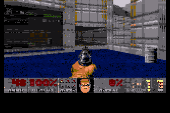

# RastaDoom

DOOM shareware Episode 1 for the **regular A8PicoCart**, using one RP2040 with
16 MB of flash and a stock 64 KB Atari 800XL. The RP2040 runs DOOM; the Atari
reads the joystick and keyboard and displays the generated native graphics.

## Download and install 0.6.0

[Download A8PicoCart-DOOM-0.6.0.uf2](A8PicoCart-DOOM-0.6.0.uf2?raw=true)

**Back up cartridge files and saves first. This UF2 replaces the cartridge
filesystem.** It already contains `DOOM.CAR`, the engine and Episode 1 data.

1. Disconnect the cartridge from the Atari and enter its RP2040 BOOTSEL USB
   mode. Copy the UF2 to the `RPI-RP2` drive.
2. After flashing finishes, disconnect USB. Insert the cartridge with the
   Atari powered off, then turn it on.
3. Select `DOOM.CAR` from the normal A8PicoCart menu.

No separate game-file copy is required. This firmware targets the standard
single-RP2040 cartridge, not A8PicoDuo.

## Controls

Press and release **fire** to open the title-screen menu, then to select New
Game, the episode and the difficulty. Each press makes one selection;
holding fire does not skip menus or shoot when the game starts.

| Control | Action |
| --- | --- |
| Joystick up/down | Menu selection; walk forward/backward during play |
| Joystick left/right | Turn during play |
| Fire | Confirm a menu selection; shoot during play |
| OPTION or Space | Open doors / use switches |
| SELECT or Escape | Open or close the menu |
| START or Return | Confirm a menu selection |
| Shift | Run |
| WASD | Move / turn |
| Q / E | Strafe |
| Number keys | Select an available weapon |

Version 0.6.0 removes the numbered startup screens and their three-second
pauses. Readiness and complete-frame checks remain internal. A failure-only
message still appears if startup or frame delivery fails.

## Renderer

RastaDoom uses a **custom Rasta-style Atari raster encoder**, inspired by the
bitmap, player-graphics and palette-program approach used by RastaConverter.
It does not run RastaConverter itself and is not an APAC renderer.

The RP2040 renders DOOM, then encodes each frame as a native **160 x 192
ANTIC E bitmap**, four player-graphics underlays, and generated 6502 code
that changes the playfield and player colors on each scanline. The graphics
and matching raster program occupy the same **16 KB cartridge window**.
The Atari selects completed frames and executes the raster program.



## Verification

The supplied 0.6.0 binary passed functional checks in native Linux
AltirraSDL with **XL OS 1.3**, 800XL/64 KB, for both NTSC and PAL:

- Fire-only menu navigation into E1M1, including held-fire behavior.
- Movement, turning, firing and input release.
- Matching completed frame windows and player-graphics copies.
- 67 engine frames and 530 raster returns in each run.
- Startup text and delays removed; failure-only timeout handling retained.
- Original firmware directory enumeration, full 16 KB CAR loading and
  launch handoff; separate instruction-model checks of the cartridge bus.
- A clean source rebuild produced the identical UF2 and CAR.

The display test runs the delivered Atari client with actual output from
the ARM engine executing in an RP2040 instruction model. A custom cartridge
adapter connects their memory and input protocol. **This is not a physical
cartridge test, a simultaneous dual-core timing test or a hardware FPS
measurement.** Audio was not exercised by this adapter. The 0.6.0 UF2 still
needs physical Atari verification.

Evidence: [NTSC](checks/release/ntsc/result.json),
[PAL](checks/release/pal/result.json),
[firmware verification](checks/release/verification.json), and
[clean rebuild](checks/release/rebuild.json).

## Build

Requirements: Python 3, ca65/ld65, CMake, Ninja, arm-none-eabi GCC/binutils,
and Pico SDK commit `bddd20f928ce76142793bef434d4f75f4af6e433` with submodules.

```sh
PICO_SDK_PATH=/path/to/pico-sdk bash rastadoom/release/build.sh
```

Outputs are written to `dist/0.6.0/`. The builder verifies the included
original-firmware input before packaging. See [README.txt](README.txt) for
test commands and [dependencies.json](checks/release/dependencies.json) for
the tested tools.

UF2 SHA-256:

```text
63b6add566f662d33956d73d973f6e0a6bd596a09a266b67587ec5d3b44aa00c
```

## Credits and licensing

- DOOM: id Software.
- RP2040 engine: Graham Sanderson and the
  [rp2040-doom](https://github.com/kilograham/rp2040-doom) contributors,
  derived from Chocolate Doom.
- A8PicoCart firmware and hardware: Robin Edwards,
  [A8PicoCart](https://github.com/robinhedwards/A8PicoCart).
- Atari adaptation, raster encoder and release integration: OpenAI Codex.
- Verification: Avery Lee's Altirra, the AltirraSDL port, and rp2040js.

This is an independent Atari adaptation. Original license notices are
retained in [COPYING.md](COPYING.md), the third-party source and
`rastadoom/licenses/`. Game data and third-party components retain their
respective terms; the GPL code license does not relicense DOOM game assets.
